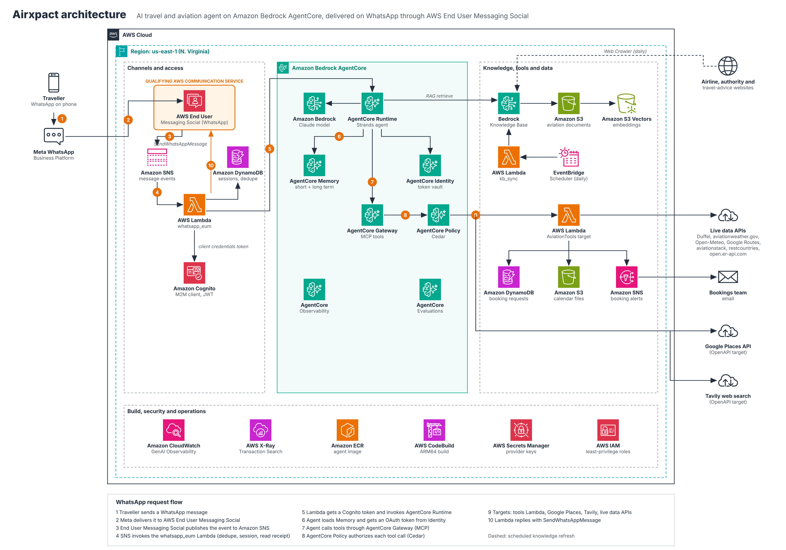

# Airxpact

Airxpact is an AI travel and aviation assistant that people use on WhatsApp. A traveller can send *"I'm going to London on 12 December, plan my trip"* and get flight options, live airport weather, a departure-day timeline, buses and transfers, places to visit, currency and language help, and booking requests, all in one conversation.

The agent runs on **Amazon Bedrock AgentCore**. It reaches travellers on WhatsApp through **AWS End User Messaging Social**, and also through a web app and a partner API.



## Features

| Capability | How it works |
| --- | --- |
| Route planning and fares | Live flight offers (Duffel) compared by price, stops, layovers and baggage; risky connections flagged |
| Aviation weather | Live METAR/TAF from aviationweather.gov explained in plain language, plus destination forecasts and current conditions (Open-Meteo) |
| Scheduling | Departure-day timeline (leave home, check-in, security, boarding) and a calendar file with reminders |
| Ground transport | Buses and trains with operators, times and fares from Google Routes; web search fallback for routes without published schedules |
| Booking requests | Bus, flight, transfer, translator, hotel and tour requests saved with an `AXP-` reference; the operations team is alerted by email and updates the status |
| Places and translators | Attractions, restaurants, hotels, translators and interpreters through Google Places |
| Currency and languages | Official currency and languages of any country, live exchange rates, replies in the traveller's language, phrase sheets for language-barrier trips |
| Flight status | Delays, terminal and gate by flight number (aviationstack) |
| Aviation knowledge | RAG over an aviation library plus airline, authority and travel-advice websites crawled daily |
| Live web search | Current facts with sources, restricted to official domains for visas and airline policies (Tavily) |
| Memory | Short-term conversation memory and long-term traveller preferences, facts and trip summaries |
| Guardrails | Cedar policies on every tool call, payment details never collected in chat, safety and legal questions referred to authorities |

## AWS services

| Service | Role |
| --- | --- |
| **AWS End User Messaging Social** | **Qualifying communication service.** WhatsApp Business Account and phone number; inbound messages published to SNS; replies and read receipts sent with `SendWhatsAppMessage` |
| Amazon Bedrock AgentCore Runtime | Hosts the agent container (Strands Agents) with JWT inbound auth |
| Amazon Bedrock AgentCore Memory | Short-term events and long-term strategies (user preferences, semantic facts, session summaries) |
| Amazon Bedrock AgentCore Gateway | Exposes Lambda and OpenAPI targets to the agent as MCP tools |
| Amazon Bedrock AgentCore Identity | Workload identity, OAuth client-credentials token for the Gateway, API key vault for Google Places and Tavily |
| Amazon Bedrock AgentCore Policy | Cedar authorization for every tool call (default deny, Enforce mode) |
| Amazon Bedrock AgentCore Observability | OpenTelemetry traces, CloudWatch GenAI Observability, Transaction Search |
| Amazon Bedrock AgentCore Evaluations | Online evaluation with built-in and custom LLM-as-a-judge evaluators |
| Amazon Bedrock (Claude) | Foundation model through a cross-region inference profile |
| Amazon Bedrock Knowledge Bases | Aviation library: S3 documents and Web Crawler data sources, S3 Vectors store |
| AWS Lambda | Channel adapters, API, Gateway tools, knowledge base refresh |
| Amazon SNS | WhatsApp event destination; booking alerts to the operations team |
| Amazon DynamoDB | WhatsApp conversation sessions and message de-duplication; booking requests |
| Amazon Cognito | Web sign-in (authorization code with PKCE) and machine-to-machine clients for channels and partners |
| AWS Amplify Hosting | Web app |
| Amazon EventBridge Scheduler | Daily knowledge base refresh |
| Amazon S3 | Knowledge documents, build source, calendar files |
| Amazon ECR and AWS CodeBuild | ARM64 container image for the agent |
| AWS Secrets Manager | Provider keys and channel credentials |
| Amazon CloudWatch and AWS X-Ray | Logs, metrics, alarms, traces |
| AWS IAM | Least-privilege roles for every component |

## How a WhatsApp message is handled

1. The traveller messages the Airxpact WhatsApp number.
2. AWS End User Messaging Social publishes the message event to an SNS topic.
3. SNS invokes `functions/whatsapp_eum`. The function drops duplicates, marks the message as read and loads the traveller's conversation session from DynamoDB.
4. The function gets a Cognito access token (client credentials) and invokes AgentCore Runtime. The phone number is hashed, so no raw numbers are stored in memory.
5. The agent loads short- and long-term memory and searches the knowledge base when needed.
6. The agent gets an OAuth token from AgentCore Identity and calls Gateway tools over MCP. AgentCore Policy allows or denies each call.
7. The answer is formatted for WhatsApp, split into parts when long, and sent with `SendWhatsAppMessage`.

The WhatsApp integration is in `functions/whatsapp_eum/lambda_function.py`:

| Function | Purpose |
| --- | --- |
| `lambda_handler` | Reads SNS records, decodes `whatsAppWebhookEntry`, takes the phone number ARN from `context.MetaPhoneNumberIds` |
| `message_text` | Turns text, button, list, location and media messages into agent input |
| `send_raw` | Calls `socialmessaging.send_whatsapp_message` with a WhatsApp Cloud API payload |
| `send_text` | Sends the answer in E.164 format, split into WhatsApp-sized parts |
| `handle_message` | De-duplication, read receipt, session, agent call and reply |

## Repository layout

```
agent/                  Agent container: agent.py, Dockerfile, requirements.txt, buildspec.yml
functions/
  whatsapp_eum/         WhatsApp channel through AWS End User Messaging Social (SNS trigger)
  whatsapp_twilio/      Optional WhatsApp channel through Twilio webhooks
  api/                  HTTPS API for the web app and partners (Lambda Function URL)
  aviation_tools/       Gateway Lambda target with 11 tools
  kb_sync/              Scheduled knowledge base refresh
gateway/                Tool schema and OpenAPI specs for the Gateway targets
policies/               Cedar policies
evaluation/             Custom evaluator prompts and acceptance tests
knowledge/              Starter aviation documents and crawl seed URLs
web/                    Web app (static, deployed to Amplify)
docs/                   Architecture diagram (PNG, SVG, draw.io), deployment guide, project story
tests/                  Unit tests
```

## Deployment

The full step-by-step setup is in [docs/deployment.md](docs/deployment.md). It is done in the AWS console, us-east-1:

1. Model access, S3 buckets, Knowledge Base, secrets.
2. Tools Lambda, Cognito, AgentCore Identity, Gateway with three targets, Policy, Memory.
3. Agent image built by CodeBuild, then hosted on AgentCore Runtime with JWT inbound auth.
4. Observability, evaluations, API Lambda, Amplify web app.
5. WhatsApp: AWS End User Messaging Social, SNS topic, `whatsapp_eum` Lambda.
6. Web crawler data sources and the daily refresh schedule.

## Configuration

**Agent runtime** (`agent/`)

| Variable | Description |
| --- | --- |
| `MODEL_ID` | Bedrock inference profile ID for Claude |
| `MEMORY_ID` | AgentCore Memory ID |
| `KB_ID` | Knowledge Base ID |
| `GATEWAY_URL` | Gateway MCP endpoint (ends with `/mcp`) |
| `GATEWAY_OAUTH_PROVIDER` | AgentCore Identity OAuth client name for the Gateway |
| `GATEWAY_SCOPE` | OAuth scope of the Gateway's Cognito resource server |
| `WORKLOAD_NAME` | Optional. Workload identity name, needed only when invoking with IAM auth |

**WhatsApp, End User Messaging** (`functions/whatsapp_eum`)

| Variable | Description |
| --- | --- |
| `AGENT_RUNTIME_ARN`, `QUALIFIER` | Runtime ARN and endpoint (`DEFAULT`) |
| `SECRET_ARN` | Secret with `cognito_client_id`, `cognito_client_secret` |
| `COGNITO_DOMAIN`, `COGNITO_SCOPE` | Cognito domain and `airxpact-api/chat` |
| `SESSIONS_TABLE` | DynamoDB table, partition key `actor_id` (String) |
| `META_API_VERSION` | Optional, default `v20.0` |

**Gateway tools** (`functions/aviation_tools`)

| Variable | Description |
| --- | --- |
| `DUFFEL_SECRET_ARN` | Secret with `api_key` |
| `TRIP_FILES_BUCKET` | Bucket for calendar files |
| `PROVIDERS_SECRET_ARN` | Secret with `google_maps_api_key`, `aviationstack_api_key` |
| `BOOKINGS_TABLE`, `BOOKINGS_TOPIC_ARN` | Booking requests table and alert topic |
| `AVIATIONSTACK_BASE` | Optional API base URL |

**API** (`functions/api`): `AGENT_RUNTIME_ARN`, `QUALIFIER`.
**Knowledge refresh** (`functions/kb_sync`): `KB_ID`.
**Twilio channel** (`functions/whatsapp_twilio`): `AGENT_RUNTIME_ARN`, `QUALIFIER`, `SECRET_ARN`, `COGNITO_DOMAIN`, `COGNITO_SCOPE`, `WHATSAPP_FROM`, `SESSIONS_TABLE`, `WEBHOOK_URL`, `FAST_REPLY_SECONDS`.

## Tests

```
pip install -r requirements-dev.txt
pytest
```

The unit tests cover the agent's calculator and date tools, the tool handlers (with provider responses mocked), WhatsApp formatting, message splitting, the End User Messaging event flow, Twilio signature validation and the API's request checks. End-to-end scenarios are listed in `evaluation/acceptance-tests.md`.

## Challenges

| Challenge | What happened | Resolution |
| --- | --- | --- |
| Channel response deadline | The first prototype used a Twilio webhook, which must answer within 15 s. Full trip plans took longer, and outbound messages were blocked until Trust Hub verification. | Moved to AWS End User Messaging Social. SNS invokes the Lambda asynchronously, so a turn can take up to the 300 s function timeout. |
| Workload token missing | With IAM inbound auth the runtime does not create a workload token, so the agent could not fetch the Gateway OAuth token. | JWT inbound auth with a Cognito client per channel (`WORKLOAD_NAME` kept as a fallback for IAM testing). |
| `invalid_grant` from Cognito | The channel app client did not have the client-credentials grant enabled. | Enabled Client credentials and the `airxpact-api/chat` scope on every machine-to-machine client. |
| `AccessDeniedException` on send | The IAM policy named the WABA ARN instead of the phone number. | `social-messaging:SendWhatsAppMessage` on `phone-number-id/*`. |
| `InvalidParametersException` on send | Numbers in the SNS event have no leading `+`. | Normalised every recipient to strict E.164. |
| Duplicate replies | SNS can deliver the same event more than once. | Conditional `msg#<id>` put in DynamoDB with a 3-day TTL. |
| Breaking dependencies | `mcp` 2.x removed the client the agent used, and the first model was retired. | Pinned versions, moved to `MCPClient(url=..., headers=...)`, model ID in an environment variable. |
| Unreliable answers | The agent stopped after "let me search", did date and fare arithmetic in its head, and quoted prices without sources. | Prompt rules, local `calculator` and `date_calculator` tools, source-or-estimate rule, consistency evaluator and acceptance tests. |
| Silent policy denials | Gateway Cedar actions are named `<Target>___<tool>` (three underscores); one typo denies the tool. | Policy engine run in Log only mode first, decisions checked in logs, then Enforce. |

## What we learned

- An event-driven channel suits agent turns that take seconds to minutes far better than a synchronous webhook.
- A separate Cognito client per caller keeps tokens, logs and policies easy to reason about, and is what makes the Gateway's outbound OAuth work.
- Models need tools for what they are bad at: a small calculator and date tool removed a whole class of wrong answers.
- Guardrails belong outside the prompt. Cedar policies at the Gateway hold even when the model is persuaded otherwise.
- Traces and online evaluations are development tools. Most bugs were found by reading a trace rather than guessing.
- Almost every blocker was spelled out in a CloudWatch log line; reading it first saved more time than any code change.

The full project story is in [docs/STORY.md](docs/STORY.md).

## Security and privacy

- Every request to the agent carries a Cognito JWT that AgentCore Runtime validates.
- Phone numbers and user IDs are hashed before they are used as memory actor IDs.
- Third-party keys live in Secrets Manager and the AgentCore Identity token vault, never in code.
- Cedar policies run outside the agent and allow only the listed tools, with limits on group sizes and result counts.
- The agent never asks for card or payment details. Bookings are requests confirmed by people.
